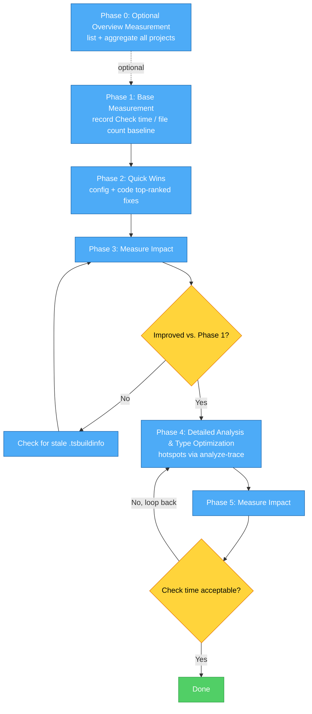

# TypeScript Performance Audit Flow



> [!NOTE]
> `tsc-diagnostics` comes from the [`@push-based/tsc-diagnostics`](https://www.npmjs.com/package/@push-based/tsc-diagnostics) package, which this repo's `npm install` already installs. In your own repo, add it with `npm i -D @push-based/tsc-diagnostics`. Its reports land in a `ts-diagnostics/` folder per project.

## Phase 0: Optional Overview Measurement

```bash
npx tsc-diagnostics list
npx tsc-diagnostics diagnostics "projects/*" --mode extendedDiagnostics
npx tsc-diagnostics aggregate "projects/*/ts-diagnostics" -o projects-diagnostics.json
```

- [ ] `list` every project path from the root tsconfig
- [ ] `aggregate` all projects' reports into one JSON to spot the worst offender before picking a Phase 1 target

## Phase 1: Base Measurement

Use [`tsc-diagnostics`](https://www.npmjs.com/package/@push-based/tsc-diagnostics) (other tools: [`tools.md`](./tools.md)):

```bash
npx tsc-diagnostics diagnostics <project> --mode extendedDiagnostics
```

- [ ] Record Check time / file count baseline

## Phase 2: Quick Wins

- [ ] Config: `incremental`, `skipLibCheck` - the top-ranked (Impact 5, Effort 1) row of the [tsconfig.json performance checklist](./tsconfig-checklist.md)
- [ ] Code: distributive conditionals, nested distributive conditionals, recursive tuple construction - the top-ranked (Impact 5) row of the [TypeScript code performance checklist](./ts-code-checklist.md)
- [ ] Verify workspace packages are consumed via built declarations, not `.ts` source ([example](../projects/test-lib-1/src/examples/03-workspace-package-as-source/README.md))
- [ ] When in doubt, confirm with `tsc --traceResolution` which file an import actually resolved to ([example](../projects/test-lib-1/src/examples/04-trace-resolution/README.md))

## Phase 3: Measure Impact

```bash
npx tsc-diagnostics diagnostics <project> --mode extendedDiagnostics
npx tsc-diagnostics compare <project>/ts-diagnostics -n <project>
```

- [ ] Check time / Types / Instantiations dropped vs. Phase 1
- [ ] If not: check for a stale `.tsbuildinfo` masking `incremental` (see [tsconfig-checklist.md](./tsconfig-checklist.md))

## Phase 4: Detailed Analysis & Type Optimization

- [ ] Identify top hotspots (files or types) - run [`tsc-diagnostics`](https://www.npmjs.com/package/@push-based/tsc-diagnostics) with `--trace`/`--analyze-trace` (wraps [`typescript-analyze-trace`](./tools.md#typescript-analyze-trace)) to get them automatically instead of browsing the raw trace by hand
- [ ] Document hotspot locations and severity
- [ ] Work through the [TypeScript code performance checklist](./ts-code-checklist.md) (distributive conditionals, recursive types, union/intersection patterns, annotation review, etc.)
- [ ] Also check the [tsconfig.json performance checklist](./tsconfig-checklist.md) - a hotspot can be a config issue (e.g. a workspace import pulling in `.ts` source instead of built `.d.ts`), not just a type-level pattern


## Phase 5: Measure Impact

```bash
npx tsc-diagnostics diagnostics <project> --mode extendedDiagnostics
npx tsc-diagnostics compare <project>/ts-diagnostics -n <project>
```

- [ ] Check time / Instantiations at the fixed hotspots dropped vs. Phase 3
- [ ] No new hotspots emerged elsewhere
- [ ] Check time acceptable → done; otherwise loop back to Phase 4
