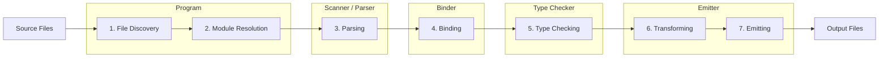

# Typescript Compiler  Process

A simplified view of the TypeScript compiler pipeline looks like this:



## Phase Section Template

Each phase below follows this structure:

```markdown
## N. Phase Name

Short description of what this phase does.

- Bullet point summary of key responsibilities
- ...

Configuration options to optimize this phase:
- `optionName`
- ...

Code adjustments to optimize this phase:
n/a | bullet list of code-level changes

Measure it with:
- `tsc --diagnostics`
- `tsc --extendedDiagnostics`

Metrics to watch:
​```
Metric Name:                  value
​```
```

## 1. File Discovery

Find all files that belong to the program.

- Read `tsconfig.json`
- Apply `files`, `include`, `exclude`
- Discover referenced projects

Configuration options to optimize this phase:
-  `include`
-  `exclude`
-  `composite`
-  `references`
-  `incremental`

Code adjustments to optimize this phase:
n/a

Measure it with:
- `tsc --diagnostics`
- `tsc --extendedDiagnostics`

Metrics to watch:
```
Files:                        165
```


## 2. Module Resolution

Resolve every import/export.

- `node_modules`
- `paths`
- `baseUrl`
- `exports`
- `package.json`
- project references

Configuration options to optimize this phase:
- `paths`
- `baseUrl`
- `moduleResolution`
- `exports` / `package.json`
- `references`

Code adjustments to optimize this phase:
n/a

Measure it with:
- `tsc --traceResolution`
- `tsc --extendedDiagnostics`

Metrics to watch:
```
Program time:                 0.50s
```

## 3. Parsing

Convert source text into an Abstract Syntax Tree (AST).
No types yet-just syntax.

Configuration options to optimize this phase:
n/a

Code adjustments to optimize this phase:
- Reduce file count / file size
- Avoid large barrel files

Measure it with:
- `tsc --extendedDiagnostics`

Metrics to watch:
```
Parse time:                   0.35s
Lines:                        88908
Nodes:                        351694
```

## 4. Binding

Walk the AST and create the symbol table.

- `variables`
- `functions`
- `classes`
- `interfaces`
- `namespaces`
- `scopes`

The binder answers questions like:

> "Where was this identifier declared?"

Configuration options to optimize this phase:
n/a

Code adjustments to optimize this phase:
- Reduce number of declarations/exports per file
- Avoid excessive namespaces

Measure it with:
- `tsc --extendedDiagnostics`

Metrics to watch:
```
Bind time:                    0.13s
Symbols:                      150809
```

## 5. Type Checking

The most expensive phase.

The checker:

- infers types
- resolves generics
- evaluates conditional types
- expands mapped types
- compares types structurally
- checks assignability
- validates function calls
- performs control-flow analysis

Most performance optimizations target this phase.

Configuration options to optimize this phase:
- `skipLibCheck`
- `incremental`

Code adjustments to optimize this phase:
- Explicit return types
- Interface vs intersection
- Smaller unions
- Simpler generics

Measure it with:
- `tsc --extendedDiagnostics`
- `tsc --generateTrace <dir>`

Metrics to watch:
```
Check time:                   1.20s
Types:                        35553
Instantiations:               8829
```

## 6. Transforming

Convert the AST into the target JavaScript representation.

Examples:

- remove types
- downlevel modern syntax
- transform decorators
- transform JSX
- rewrite module syntax

Skipped when using --noEmit.

Configuration options to optimize this phase:
- `target`
- `isolatedModules`

Code adjustments to optimize this phase:
n/a

Measure it with:
- `tsc --extendedDiagnostics`

Metrics to watch:
```
transformTime time:           0.02s
```

## 7. Emitting

Write output files.

Possible outputs include:

- `.js`
- `.d.ts`
- `.js.map`
- `.d.ts.map`
- `.tsbuildinfo`

Configuration options to optimize this phase:
- `noEmit`
- `emitDeclarationOnly`
- `isolatedDeclarations`
- `declaration`
- `declarationMap`
- `sourceMap`

Code adjustments to optimize this phase:
n/a

Measure it with:
- `tsc --extendedDiagnostics`

Metrics to watch:
```
Emit time:                    0.05s
```


| Optimization               | File Discovery | Module Resolution | Parsing | Binding | Type Checking | Transforming | Emitting |
| -------------------------- | :------------: | :----------------: | :-----: | :-----: | :------------: | :----------: | :------: |
| `include` / `exclude`      |       ✅        |         -          |    -    |    -    |       -        |      -       |    -     |
| Project References         |       ✅        |         -          |    -    |    -    |       -        |      -       |    -     |
| `paths`                    |       -         |         ✅          |    -    |    -    |       -        |      -       |    -     |
| `skipLibCheck`             |       -         |         -          |    -    |    -    |       ✅        |      -       |    -     |
| Explicit return types      |       -         |         -          |    -    |    -    |       ✅        |      -       |    -     |
| Interface vs intersection  |       -         |         -          |    -    |    -    |       ✅        |      -       |    -     |
| Smaller unions             |       -         |         -          |    -    |    -    |       ✅        |      -       |    -     |
| Simpler generics           |       -         |         -          |    -    |    -    |       ✅        |      -       |    -     |
| `incremental`              |       ✅        |         -          |    -    |    -    |       ✅        |      -       |    -     |
| `noEmit`                   |       -         |         -          |    -    |    -    |       -        |      -       |    ✅     |
| `emitDeclarationOnly`      |       -         |         -          |    -    |    -    |       -        |      -       |    ✅     |
| `isolatedDeclarations`     |       -         |         -          |    -    |    -    |       -        |      -       |    ✅     |
| `declaration`              |       -         |         -          |    -    |    -    |       -        |      -       |    ✅     |

In practice, Type Checking dominates compile time for most large TypeScript projects, which is why the majority of performance guidance focuses on reducing the work done in that stage.
