# Where TypeScript Runs: CLI, IDE, CI

TypeScript's compiler pipeline (see [process.md](./process.md)) is shared by
every surface that touches your code, but each surface enters it through a
different process with different goals.

## The three entry points

```mermaid
flowchart LR
    subgraph CLI["tsc (CLI)"]
        direction TB
        A1["tsc"] --> A2["one-shot: check + emit"]
        A3["tsc --noEmit"] --> A4["one-shot: check only"]
        A5["tsc -b"] --> A6["build mode: project refs + .tsbuildinfo"]
        A7["tsc -w / -b -w"] --> A8["long-lived: re-run on file change"]
    end

    subgraph IDE["tsserver (IDE)"]
        direction TB
        B1["Language Service"] --> B2["long-lived: in-memory Program, per-keystroke incremental check"]
        B2 --> B3["TS plugins (tsconfig.json plugins)"]
    end

    subgraph CI["CI"]
        direction TB
        C1["tsc --noEmit / tsc -b"] --> C2["gate: fail build on type errors"]
    end
```

- **CLI (`tsc`)** - one-shot invocation, run once and exit. Used locally and
  in scripts/CI.
- **IDE (`tsserver`)** - a long-lived Language Service process. It never
  calls `tsc` directly; it keeps a `Program` resident in memory and
  re-runs Parse → Bind → Check incrementally per file/keystroke to power
  hover, autocomplete, and red squiggles. TS plugins (`tsconfig.json`
  `plugins`) hook into this Language Service only - they're invisible to
  `tsc`/CI and can slow down `tsserver` if they're heavy.
- **CI** - almost always just the CLI again, typically `tsc --noEmit` (pure
  type-check gate) or `tsc -b` (incremental project-reference build).

`tsc -w` (watch mode) sits conceptually between the CLI and `tsserver`: a
long-lived process that re-checks on change, but still driven by the CLI
entry point rather than the Language Service API.

## What connects them

- **Same `tsconfig.json`** - `skipLibCheck`, `incremental`, `strict`, etc.
  apply identically whether the phase runs from `tsc`, `tsc -w`, or
  `tsserver`.
- **Same expensive phase** - Type Checking dominates in all three. A type
  that's slow to check in CI is the same type that makes the IDE laggy
  (slow hover/autocomplete/red squiggles).
- **`.tsbuildinfo`** - produced by `incremental`/`composite`. A local
  `tsc -b` run and a CI run against the same cache both skip re-checking
  unchanged files. `tsserver` does *not* read this file - it maintains its
  own separate in-memory incremental state.

## Why this matters for performance work

Because all three surfaces bottleneck on the same Type Checking phase,
optimizations documented per-phase in [process.md](./process.md) (explicit
return types, simpler generics, `skipLibCheck`, etc.) pay off everywhere at
once:

**CLI / CI**
- Long `tsc` / `tsc -b` wall-clock time
- Slow pipeline gates, longer time-to-merge
- CI runners timing out or needing bigger machines
- Cold-cache builds (no `.tsbuildinfo`) taking disproportionately long

**IDE (`tsserver`)**
- Slow hover and "Go to Definition"
- Delayed or stalled autocomplete
- Red squiggles lagging behind what you just typed
- Editor freezing briefly on save or file switch
- High CPU/memory from the `tsserver` process

**Watch mode**
- Long delay between save and rebuild feedback
- Rebuilds that don't feel "incremental" even for a one-line change
- Terminal spinner sitting for seconds before re-running tests/type-check

There's no separate "IDE-only" or "CI-only" optimization - fixing a
type-checking hotspot once improves developer experience across every
entry point.

## Table

| Surface                    | Program/tsc Command          | File Discovery | Module Resolution | Parsing | Binding | Type Checking | Transforming | Emitting |
| --------------------------- | ----------------------------- | :------------: | :----------------: | :-----: | :-----: | :------------: | :----------: | :------: |
| CLI (full compile)          | `tsc`                          |       ✅        |         ✅          |    ✅    |    ✅    |       ✅        |      ✅       |    ✅     |
| CLI (type-check only)       | `tsc --noEmit`                 |       ✅        |         ✅          |    ✅    |    ✅    |       ✅        |      -       |    -     |
| CLI (build mode)            | `tsc -b`                       |       ✅        |         ✅          |    ✅    |    ✅    |       ✅        |      ✅       |    ✅     |
| IDE                         | `tsserver` (Language Service)   |       ✅        |         ✅          |    ✅    |    ✅    |       ✅        |      -       |    -     |
| CI                          | `tsc --noEmit` / `tsc -b`       |       ✅        |         ✅          |    ✅    |    ✅    |       ✅        |     ✅*       |    ✅*    |
| CLI (watch mode)  | `tsc -w` / `tsc -b -w`          |       ✅        |         ✅          |    ✅    |    ✅    |       ✅        |      ✅       |    ✅     |

